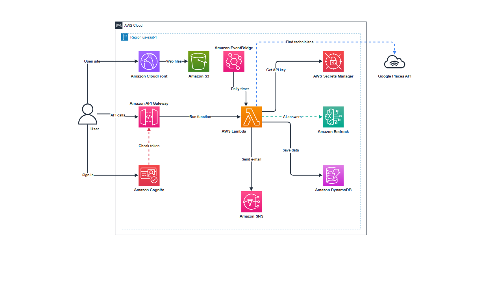
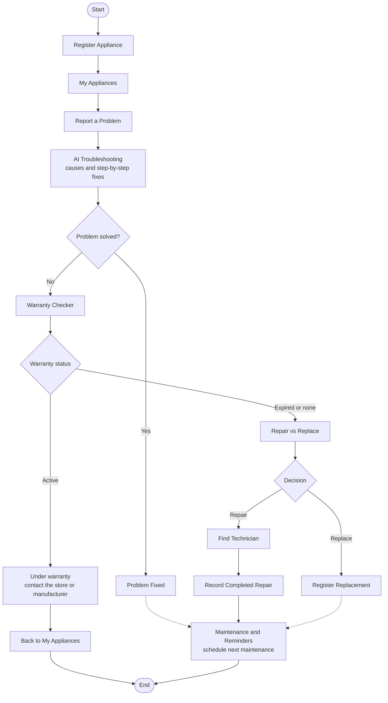

# ClueNest AI: Serverless Home Appliance Assistant on AWS

## Introduction

ClueNest AI helps households keep track of their home appliances in one place. Users register appliances, report problems, get troubleshooting guidance, check warranties, decide between repair and replacement, find local technicians, record repairs and schedule maintenance reminders.

Many people lose warranty details, forget routine maintenance and have no record of past repairs. The goal of this project was to build a secure, low-cost application that solves this without servers to manage, using a fully serverless AWS architecture with a plain HTML, CSS and JavaScript frontend.

## Features

- **My Appliances:** register and manage appliances with brand, model, purchase date and warranty.
- **AI Troubleshooting:** possible causes and step-by-step solutions for a reported problem. It uses Amazon Bedrock, or a built-in Demo Mode (clearly labelled) while Bedrock quota is unavailable.
- **Warranty Checker and Repair vs Replace:** guidance on whether to repair or replace.
- **Find Technician:** local repair services from Google Places, with call and website links.
- **Record Completed Repair:** from a technician card, save the repair details and cost, then continue straight to scheduling the next maintenance.
- **Repair History:** a record of problems, repairs and expenses, stored in the backend.
- **Maintenance Reminders:** one-time and repeating reminders (monthly, every 3 months, every 6 months, yearly).
- **E-mail reminders:** an optional daily e-mail for due maintenance, sent through Amazon SNS.
- **Dashboard:** upcoming and overdue maintenance, warranty overview, repair spending and recent activity.

## Architecture & Tech Stack

### Architecture Overview



The editable draw.io source is [`docs/architecture/cluenest-aws-architecture-clean.drawio`](docs/architecture/cluenest-aws-architecture-clean.drawio).

### AWS Services Used

- **Amazon CloudFront:** global content delivery for the website, with HTTPS
- **Amazon S3:** hosts the static frontend files
- **Amazon Cognito:** user sign-up and sign-in (hosted pages, authorization code flow with PKCE)
- **Amazon API Gateway (HTTP API):** the REST API, protected by a JWT authorizer with read and write scopes
- **AWS Lambda:** the backend functions (Python)
- **Amazon DynamoDB:** single table for appliances, repair records and maintenance reminders
- **Amazon Bedrock:** AI troubleshooting (with a labelled demo mode)
- **AWS Secrets Manager:** stores the Google Places API key
- **Amazon EventBridge:** daily schedule for maintenance reminders
- **Amazon SNS:** e-mail notifications, one topic per user
- **AWS CloudFormation:** the whole backend and hosting setup in one template

### Request Flow

1. The user opens the CloudFront address and the static site loads from S3.
2. The user signs in on the Cognito hosted pages and the browser receives an access token.
3. The frontend calls API Gateway with `Authorization: Bearer <access token>`.
4. The JWT authorizer checks the token and its scope (`cluenest-api/read` for GET routes, `cluenest-api/write` for POST, PUT and DELETE).
5. API Gateway invokes the matching Lambda function. The user is identified only by the token, never by a value sent from the browser.
6. The function reads or writes DynamoDB, or calls Bedrock, or calls Google Places with the key from Secrets Manager.
7. Every day EventBridge starts a reminder function that finds due maintenance and publishes to the user's SNS topic.

### Application Workflow



Solid arrows are working today. If the warranty is active, the app shows the "Good News" message with guidance for contacting the store or manufacturer, and does not send the user to Repair vs Replace or Find Technician. If the warranty is expired or missing, the repair path continues as shown. Dashed arrows are planned: after "Problem Fixed" and after a replacement, the user can already open Maintenance and Reminders from the appliance card, but the app does not take them there automatically yet. The "Register Replacement" screen is still a placeholder.
### API Routes

| Area | Routes |
|---|---|
| Appliances | `GET`/`POST /appliances`, `GET`/`PUT`/`DELETE /appliances/{id}` |
| Maintenance | `GET`/`POST /maintenance`, `GET`/`PUT`/`DELETE /maintenance/{id}`, `POST /maintenance/{id}/complete` |
| Repair history | `GET`/`POST /repair-history`, `GET`/`PUT`/`DELETE /repair-history/{id}` |
| Troubleshooting | `POST /troubleshoot` |
| Technicians | `GET /technicians/search` |
| Notifications | `GET`/`PUT /notifications/preferences` |

### Key Architecture Benefits

- Serverless and fully managed
- No servers to patch or scale
- Secure by default: HTTPS, token-based access, per-user data isolation, least-privilege IAM
- Pay-as-you-go pricing
- One template and one stack, so the setup is repeatable

## Project Structure

```
ClueNest AI/
├── frontend/                  Plain HTML, CSS and JavaScript (no build step)
│   ├── index.html
│   ├── css/
│   ├── js/                    Screens, API client, sign-in, navigation
│   └── tests/                 Frontend tests (Node)
├── backend/
│   ├── cloudformation/
│   │   └── cluenest-infrastructure.yaml   The single stack template
│   ├── lambda/src/            Lambda function code (Python)
│   └── README.md              Detailed backend documentation
└── docs/architecture/         Architecture diagram (PNG and draw.io)
```

## Result & Demo

### Results

- Working end-to-end workflow: report a problem, troubleshoot, check warranty, repair or replace, find a technician, record the repair and schedule the next maintenance
- Repair records and reminders saved in DynamoDB and available on any device
- Optional daily maintenance e-mails
- Automated tests for the frontend, backend and template

### Live Demo

The development site is hosted at https://d2z1tywpqu8eb2.cloudfront.net/. Registration and sign-in are handled by Cognito.

## Deployment Instructions

The backend and hosting are deployed with **AWS CloudFormation**. Full details are in [`backend/README.md`](backend/README.md).

### Prerequisites

- An AWS account
- AWS CLI installed and configured
- Python 3.12 (to package the Lambda functions) and Node.js 20 or newer (for the frontend tests)
- An S3 bucket for deployment artifacts (the Lambda zip and the large template)
- A Google Places API key, stored in Secrets Manager after the stack is created
- Optional: Amazon Bedrock model access. Without it the app uses the labelled Demo Mode.

### Deployment Steps

**1. Clone the repository**
```bash
git clone https://github.com/Govinder-1992/ClueNest-AI.git
cd ClueNest-AI
```

**2. Package the Lambda code and upload it**

Zip the files in `backend/lambda/src/` and upload the zip to your artifacts bucket:
```bash
aws s3 cp cluenest-backend-<version>.zip s3://<ARTIFACT_BUCKET>/lambda/cluenest-backend-<version>.zip
```

**3. Deploy the CloudFormation stack**

The template is larger than the direct upload limit, so deploy it through the artifacts bucket:
```bash
aws cloudformation deploy \
  --template-file backend/cloudformation/cluenest-infrastructure.yaml \
  --stack-name cluenest-infrastructure-dev \
  --s3-bucket <ARTIFACT_BUCKET> \
  --capabilities CAPABILITY_NAMED_IAM \
  --parameter-overrides Environment=dev LambdaCodeBucket=<ARTIFACT_BUCKET> LambdaCodeKey=lambda/cluenest-backend-<version>.zip
```
Review the change set before applying it to an existing stack.

**4. Add the Google Places key**

Put the key in the secret the stack created (see the "Secrets Manager" section of `backend/README.md`). Never commit keys to the repository.

**5. Configure the frontend**

Set the stack outputs (API address, Cognito pool, client and hosted domain) in `frontend/js/config.js`. It holds public values only.

**6. Upload the website to S3**
```bash
aws s3 sync frontend/js  s3://<FRONTEND_BUCKET>/js  --delete --exclude "*" --include "*.js"  --content-type "text/javascript; charset=utf-8" --cache-control "public, max-age=300"
aws s3 sync frontend/css s3://<FRONTEND_BUCKET>/css --delete --exclude "*" --include "*.css" --content-type "text/css; charset=utf-8" --cache-control "public, max-age=300"
aws s3 sync frontend     s3://<FRONTEND_BUCKET>     --exclude "*" --include "index.html" --content-type "text/html; charset=utf-8" --cache-control "public, max-age=300"
aws cloudfront create-invalidation --distribution-id <DISTRIBUTION_ID> --paths "/*"
```
The bucket name and distribution ID are stack outputs. `README.md` and `tests/` are not uploaded.

**7. Open the site**

Open the CloudFront address from the stack outputs and sign in.

### Run Locally

```bash
cd frontend
python -m http.server 5500
```
Open http://localhost:5500/ (use `localhost`, not `127.0.0.1`). Cognito only accepts the callback addresses registered on the app client.

### Run the Tests

```bash
node --test "frontend/tests/*.test.js"
```
Backend and template tests are described in [`backend/README.md`](backend/README.md).

## Security

- Tokens are kept in `sessionStorage` and never in `localStorage`.
- The API accepts only Cognito **access** tokens with the right scope.
- Each user can reach only their own data.
- The Google key lives in Secrets Manager and is never in the frontend or the repository.
- Each function has its own least-privilege IAM role.

## Impact & Value

### Technical Impact

- A complete serverless application with no servers to maintain
- One repeatable CloudFormation stack for the backend and hosting
- Secure authentication and per-user data isolation
- Backend-saved data that works across devices

### Business Value

- Households keep warranties, repairs and maintenance in one place
- Fewer missed maintenance tasks through reminders and e-mails
- Better repair or replace decisions from recorded history and costs
- Low running cost with pay-as-you-go services

## Key Learnings

- Designing a secure, multi-user serverless application on AWS
- Protecting an API with Cognito scopes and JWT authorizers
- Using CloudFormation change sets for safe, reviewed updates
- Building a workflow that carries context across several screens
- Testing a serverless app with unit tests and real-browser runs

---

⭐ If you found this project helpful, feel free to star the repository!
